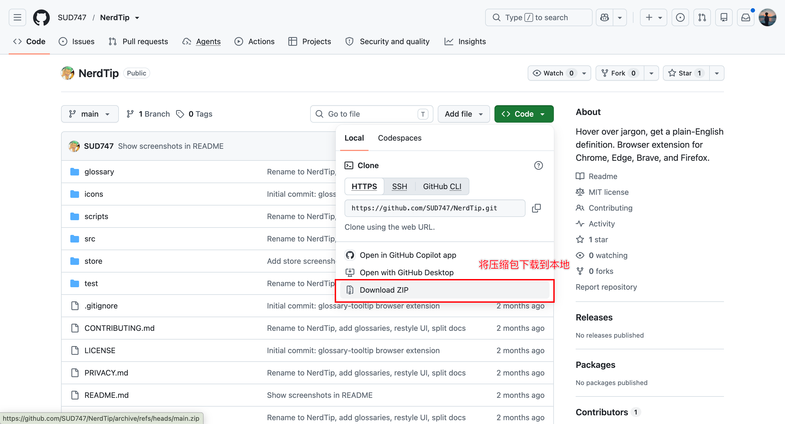
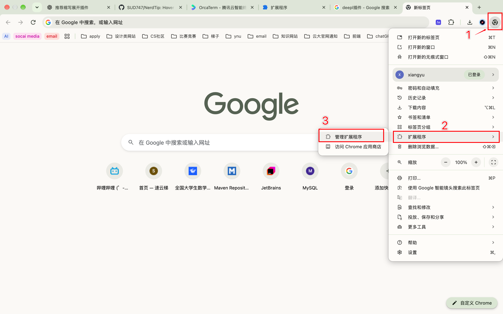
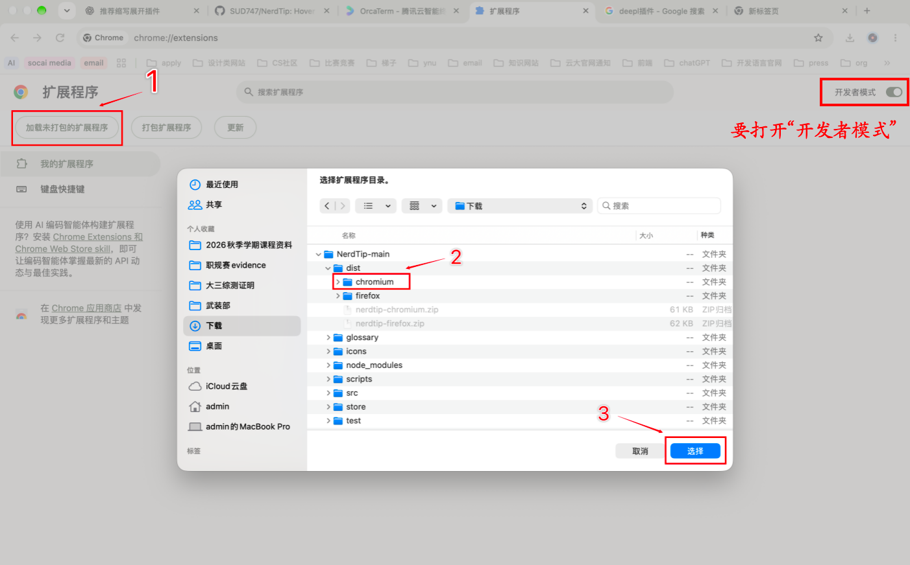
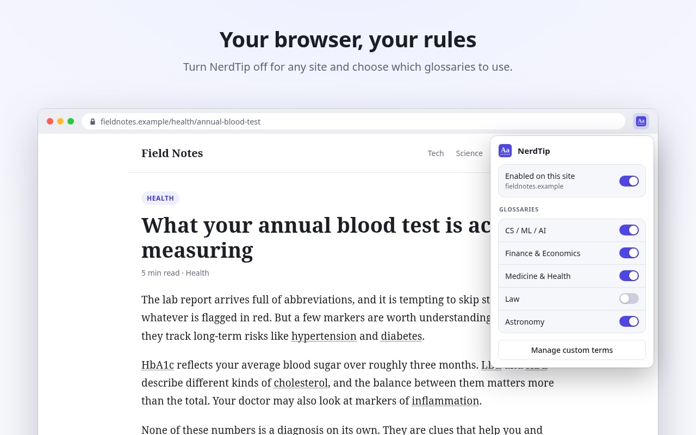
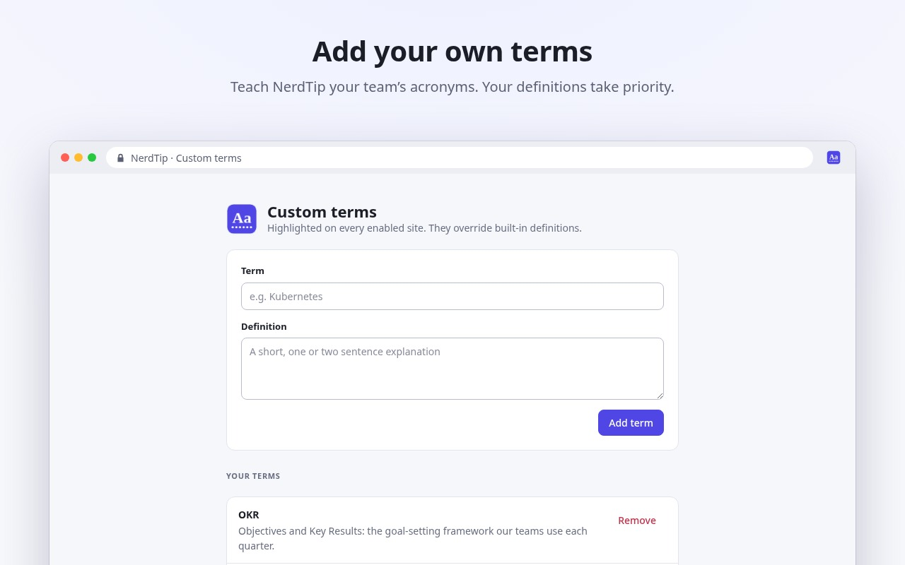

<p align="center">
  
</p>

<h1 align="center">NerdTip</h1>

<p align="center"><strong>Hover over jargon, get a plain-English definition.</strong></p>

<p align="center">
  Chrome · Edge · Brave · Firefox
</p>

---

Ever read an article packed with terms like **RAG**, **EBITDA**, **metastasis**, or **habeas corpus** and had to open a new tab to look them up? NerdTip underlines jargon on any web page. Hover over it and a short definition appears right where you're reading.

<p align="center">
  
</p>

## Features

- **Works on any website.** News, docs, research papers, forums.
- **Hover to learn.** A clean tooltip with a one or two sentence definition appears next to your cursor.
- **Stays out of the way.** Only the first mention of each term is underlined. Code blocks, text boxes, and hidden text are left alone.
- **Keeps up with dynamic pages.** Content that loads as you scroll gets highlighted too.
- **Turn it off per site.** One click in the toolbar popup.
- **Choose your glossaries.** Turn on only the subjects you care about.
- **Add your own terms.** Teach NerdTip your team's acronyms or your field's vocabulary.
- **Private by design.** Everything happens in your browser. No accounts, no tracking, no network requests.
- **Light and dark mode.** Follows your system theme.

## Built-in glossaries

| Glossary | Terms | Examples |
|---|---:|---|
| 💻 CS / ML / AI | 143 | API, Docker, race condition, transformer, RAG, quantization |
| 📈 Finance & Economics | 67 | ETF, P/E ratio, 401(k), yield curve, stablecoin |
| 🩺 Medicine & Health | 63 | MRI, HbA1c, metastasis, SSRI, CRISPR |
| ⚖️ Law | 51 | habeas corpus, force majeure, NDA, GDPR |
| 🔭 Astronomy | 73 | light-year, exoplanet, redshift, dark matter, Lagrange point |

## Install

Store listings are coming soon:

- **Chrome & Brave:** Chrome Web Store *(coming soon)*
- **Edge:** Microsoft Edge Add-ons *(coming soon)*
- **Firefox:** Firefox Add-ons *(coming soon, requires Firefox 140+)*

Until then, you can install NerdTip from source. See [Loading the extension](CONTRIBUTING.md#loading-the-extension).

## Installation Guide / 安装指南
### step 1:  Download the Project / 下载项目  

Download the ZIP package from the GitHub repository by clicking Code → Download ZIP.

### step 2:  Extract the ZIP File / 解压文件 

Extract the downloaded ZIP file and navigate to the extracted project folder.

解压下载的 ZIP 文件，并进入项目根目录。

### step 3: Build the Extension / 构建插件
Open a terminal and navigate to the project's root directory.

打开终端，并确保当前工作目录为项目根目录。
You can verify your current directory by running:

使用以下命令检查当前目录：
```sh
#检查自己是否在根目录下
pwd

# 预期输出：
# admin@admindeMacBook-Pro NerdTip-main % pwd
# /Users/admin/Downloads/NerdTip-main
```
Make sure the project root contains the scripts directory and the manifest.json file.

确认项目根目录中包含 scripts 文件夹和 manifest.json 文件。

Then run the build script:

在项目根目录下执行以下构建命令：
```bash
sh scripts/build.sh
```
Prerequisites / 环境要求：
```txt
Node.js and npm（Node.js 和 npm）

zip command-line utility（ZIP 命令行工具）
```
After a successful build, the following directories will be generated:

构建成功后，将生成以下文件：
```txt
dist/
├── chromium/              # Chrome / Edge / Brave
├── firefox/               # Firefox
```

### step 4:  Open the Browser Extensions Page / 打开浏览器扩展管理页面
open chrome or firefox web, navigate to the extensions management page

### step 5:Load the Extension / 加载插件
Select the following folder:

选择构建生成的 Chromium 文件夹：


Make sure you select the folder containing manifest.json, not the ZIP file.

请注意，选择的是包含 manifest.json 的文件夹，而不是 ZIP 压缩包。
### Final 最终效果：
Hover over a recognized abbreviation to view its full form or explanation.

将鼠标悬停在已识别的缩写上，即可查看对应的英文全称或解释。

支持自定义简写词库

## How to use

1. **Browse normally.** Jargon on the page gets a subtle dotted underline.
2. **Hover over an underlined word** to see its definition and which glossary it came from.
3. **Click the NerdTip icon** in your toolbar to:
   - turn NerdTip off for the current site
   - choose which glossaries are active
4. **Add custom terms** from the popup via **Manage custom terms**. Your definitions take priority over the built-in ones.

<table>
  <tr>
    <td width="50%"></td>
    <td width="50%"></td>
  </tr>
  <tr>
    <td align="center">Turn it off per site and pick glossaries</td>
    <td align="center">Add your own terms</td>
  </tr>
</table>

## FAQ

**Nothing is highlighted on a page.**
Reload the tab. Pages that were already open when you installed NerdTip need a refresh. Also check that the site isn't turned off in the popup.

**It doesn't work on some pages.**
Browsers don't let extensions run on internal pages such as `chrome://` or `about:` pages, the new-tab page, or extension stores.

**Firefox: nothing gets highlighted anywhere.**
Open `about:addons` → NerdTip → **Permissions** and allow access to all websites.

**A site looks or behaves oddly with NerdTip on.**
Turn NerdTip off for that site from the popup, and please [report it](CONTRIBUTING.md#reporting-bugs) so it can be fixed.

**A common word is being highlighted by mistake.**
Please report it. Glossaries deliberately avoid everyday words, so false matches are bugs.

## Privacy

NerdTip doesn't collect or send any data. Page text is checked locally against glossaries bundled in the extension. Your settings and custom terms stay in your browser. Read the full [privacy policy](PRIVACY.md).

## Contributing

Want to add a glossary, fix a definition, or improve the code? Contributions are welcome. See [CONTRIBUTING.md](CONTRIBUTING.md).

## License

[MIT](LICENSE)
